 

 

---

## About

Final-year B.Tech AI student building agentic and generative AI systems for healthcare and multilingual, voice-first products. I focus on turning research ideas into deployable software, with a goal of Scopus-indexed publication.

## Focus

- **Agentic AI:** multi-agent systems with LangGraph and CrewAI
- **LLM applications:** retrieval-augmented generation (RAG) and FastAPI services
- **Healthcare AI:** medical imaging and clinical decision support
- **Voice:** speech-to-text and text-to-speech, including Tamil

## Featured work

| Project | What it does | Stack |
|---|---|---|
| **Agentic Second-Opinion System** *(in progress)* | Multi-agent triage support for rural clinics | MedGemma, MCP, LangGraph, FastAPI |
| **Bone Fracture Detection** | X-ray diagnosis with explainable heatmaps and voice reports | EfficientNetV2, Grad-CAM, Streamlit |
| **Agentic Hotel Assistant** | Multilingual voice booking and customer support agents | CrewAI, FastAPI, STT, TTS |
| **Health Chatbot** | AI triage and emergency assistance | MedGemma, FastAPI, MCP |

## Experience

**Software Intern, Uniq Technologies** · May to June 2026
Python and generative AI application development.

## Recognition

- 🥈 **2nd Place**, StartupTN Tamizhi Language Technology Hackathon
- 🏅 **Top 20**, Shine Healthcare Hackathon

## Skills

**Languages:** Python · Java · SQL

**AI:** LLMs · RAG · Agentic AI · NLP · Deep Learning · Computer Vision

**Frameworks:** LangChain · LangGraph · CrewAI · LlamaIndex · Hugging Face · FastAPI

**Tools and cloud:** AWS · Docker · Linux · Git

## Certifications

AWS · Microsoft & Scaler · DeepLearning.AI · Activeloop · Hugging Face · Agenticacademy.ai

## GitHub

---

**Open to AI/ML engineering roles and research collaborations.**

