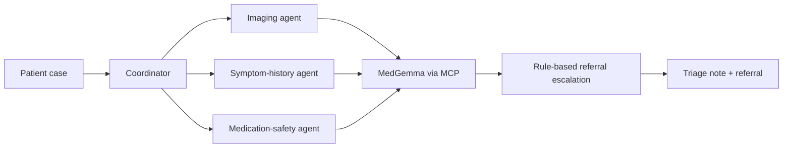

 

  

---

## ◆ About

I build AI systems that leave the notebook. My work sits where **LLMs, retrieval, and agents** meet real constraints: clinics with one doctor and no specialists, farmers who speak Tamil, hotel guests who want to talk instead of type.

Final-year **B.Tech CSE (Artificial Intelligence)** at **Karunya Institute of Technology and Sciences**. I aim to publish in Scopus-indexed venues alongside shipping software.

## ◆ Now building

**Agentic Multi-Specialist Second-Opinion System for Rural Diagnostic Triage**

A multi-agent system where specialist agents (imaging, symptom history, medication safety) reason over a case and a coordinator produces an escalation decision. Built on MedGemma exposed through MCP, with a Tamil and English voice pipeline.

Design decisions I'm committed to:

- No custom training datasets. Agents reason through MedGemma and MCP-exposed tools.
- Clinical summaries are template-filled, not free-generated, to reduce hallucination risk.
- JSON-defined agent I/O schemas with LangGraph state passing.

## ◆ Featured projects

### Health Chatbot · *Shine Healthcare Hackathon* · `2025`
AI healthcare chatbot with MCP integration, SOS alerts, hospital discovery, and AI-based triage for real-time medical assistance.
**Stack:** MedGemma-27B · FastAPI · Hugging Face Transformers · MCP

### Bone Fracture Detection & Diagnosis · `2025 – 2026`
X-ray fracture diagnosis with Grad-CAM explanations, multilingual translation, and text-to-speech medical reporting.
**Stack:** EfficientNetV2 · Grad-CAM · MedGemma · Streamlit · Modal GPU

### Agentic AI Hotel Assistant · `2026`
Multilingual multi-agent hotel assistant handling autonomous booking management, customer support, and real-time voice interaction.
**Stack:** CrewAI · FastAPI · STT · TTS

## ◆ Experience

**Uniq Technologies** · Software Intern · `05/2026 – 06/2026`
Python and Generative AI application development on assigned engineering tasks.

## ◆ Stack

## ◆ Recognition

- 🥈 **2nd Place**, StartupTN *Tamizhi* Language Technology Hackathon
- 🏅 **Top 20**, Shine Healthcare Hackathon

## ◆ Certifications

AWS · Machine Learning, Generative AI · Microsoft & Scaler · NLP, Deep Learning · DeepLearning.AI · Prompt Engineering · Activeloop · RAG Systems · Hugging Face · MCP · Agenticacademy.ai · Agentic AI

## ◆ GitHub

---

**Let's build something that matters.**

