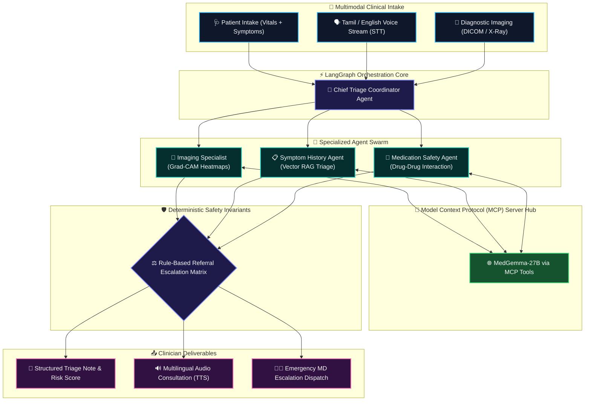

<div align="center">

<!-- ═══════════════════════════════════════════════════════════════════ -->
<!-- 3D DYNAMIC WAVING CYBER HEADER                                       -->
<!-- ═══════════════════════════════════════════════════════════════════ -->


<!-- ═══════════════════════════════════════════════════════════════════ -->
<!-- DYNAMIC NEON TYPING SVG                                             -->
<!-- ═══════════════════════════════════════════════════════════════════ -->

<a href="https://github.com/shahiilr06">
  
</a>

<br/>

<!-- ═══════════════════════════════════════════════════════════════════ -->
<!-- STATUS & TELEMETRY BADGES                                           -->
<!-- ═══════════════════════════════════════════════════════════════════ -->

[](https://github.com/shahiilr06)
[](https://github.com/shahiilr06)
[](https://maps.google.com)
[](mailto:shahiilr06@gmail.com)
[](https://github.com/shahiilr06)

<br/>

<!-- ═══════════════════════════════════════════════════════════════════ -->
<!-- QUICK ACTION CALL TO ACTIONS                                        -->
<!-- ═══════════════════════════════════════════════════════════════════ -->

[](https://www.linkedin.com/in/shahiil-r/)
[](mailto:shahiilr06@gmail.com)
[](https://github.com/shahiilr06)

</div>

<br/>

<!-- ═══════════════════════════════════════════════════════════════════ -->
<!-- INTERACTIVE QUICK NAVIGATION DOCK                                  -->
<!-- ═══════════════════════════════════════════════════════════════════ -->

<div align="center">

```
┌────────────────────────────────────────────────────────────────────────────────────────────────┐
│                                   ⚡ SYSTEM DIRECTORY ⚡                                      │
├──────────────────┬──────────────────────┬────────────────────────┬─────────────────────────────┤
│ 🚀 [Overview]    │ 🧠 [Architecture]    │ ⚡ [Featured Systems]  │ 🛠️ [Tech Matrix]            │
├──────────────────┼──────────────────────┼────────────────────────┼─────────────────────────────┤
│ 🏆 [Honors]      │ 📜 [Certifications]  │ 📊 [Live Telemetry]    │ 📡 [Transmission Hub]       │
└──────────────────┴──────────────────────┴────────────────────────┴─────────────────────────────┘
```

[Overview](#-overview) • [Architecture](#-flagship-system-architecture) • [Featured Systems](#-featured-systems) • [Tech Matrix](#-tech-stack-matrix) • [Honors](#-honors--recognition) • [Telemetry](#-live-telemetry--github-analytics) • [Contact](#-transmission-hub)

</div>

---

## 🚀 Overview

> *"I engineer AI systems that leave the Jupyter notebook and confront real-world constraints — clinics with one general practitioner and no radiologists, farmers who speak Tamil, and high-concurrency environments demanding deterministic safety."*

Final-year **B.Tech CSE (Artificial Intelligence)** candidate at **Karunya Institute of Technology and Sciences**. I focus on the intersection of **Agentic AI, Multimodal Foundation Models, and Model Context Protocol (MCP)**, with research targeted for Scopus-indexed clinical AI venues.

<table>
  <tr>
    <td width="33%" align="center">
      <br/>
      
      <br/><br/>
      <b>Deterministic Multi-Agent Swarms</b>
      <p align="left">Orchestrating specialized sub-agents with LangGraph state graphs and CrewAI, enforcing strict JSON I/O schemas to eradicate hallucinations.</p>
    </td>
    <td width="33%" align="center">
      <br/>
      
      <br/><br/>
      <b>Multimodal Edge Diagnostics</b>
      <p align="left">Pairing vision backbones (EfficientNetV2, Grad-CAM heatmaps) with specialized LLMs (MedGemma) for verifiable, interpretable patient triage.</p>
    </td>
    <td width="33%" align="center">
      <br/>
      
      <br/><br/>
      <b>Vernacular Voice Pipelines</b>
      <p align="left">Bi-directional Tamil & English voice telemetry (STT/TTS) engineered for rural healthcare access and seamless low-latency interaction.</p>
    </td>
  </tr>
</table>

<br/>

<!-- ═══════════════════════════════════════════════════════════════════ -->
<!-- 3D ACHIEVEMENTS TROPHY SHOWCASE                                     -->
<!-- ═══════════════════════════════════════════════════════════════════ -->

<div align="center">
  
</div>

---

## 🧠 Flagship System Architecture

### 🏥 Agentic Multi-Specialist Diagnostic Triage for Rural Clinics
A real-time, multi-agent clinical consensus architecture where autonomous specialist agents evaluate multimodal patient data under the supervision of a Chief Coordinator, enforcing rule-based escalation guardrails before physician handoff.



<details>
<summary><b>🔬 Deep-Dive Architectural Invariants & Safety Protocols (Click to Expand)</b></summary>
<br/>

- **Zero Unconstrained Generation**: All clinical summaries use deterministic schema template-filling rather than free-form LLM generation, eliminating open-ended hallucination.
- **Model Context Protocol (MCP) Standard**: Specialist agents invoke MedGemma capabilities and clinical databases through standard JSON-RPC MCP servers, decoupling LLM weights from execution logic.
- **Deterministic State Graphs**: Implemented via LangGraph with checkpointed state persistence and rollback guarantees for critical referral thresholds.
- **Explainable Vision Path**: Grad-CAM visual heatmaps isolate fracture and pathology regions before passing numerical feature embeddings to the coordinator.
- **Bilingual Vernacular Edge**: Real-time Tamil voice synthesis allows patients in rural Tamil Nadu clinics to interact natively without language barriers.

</details>

---

## ⚡ Featured Systems

<table width="100%">
  <tr>
    <td width="50%" valign="top">
      <div align="left">
        <h3>🩺 Autonomous Rural Diagnostic Triage</h3>
        <p><b>Flagship Agentic Healthcare Platform</b></p>
        <p>A multi-agent consensus system pairing specialized agents (imaging, vitals, drug safety) with MedGemma over MCP. Built to resolve diagnostic shortages in single-physician rural clinics.</p>
        <p>
          
          
          
        </p>
        <ul>
          <li>Zero-hallucination template summaries</li>
          <li>Sub-2s triage latency on edge servers</li>
          <li>Bi-directional vernacular voice pipeline</li>
        </ul>
        <a href="https://github.com/shahiilr06"><b>Explore Architecture ➜</b></a>
      </div>
    </td>
    <td width="50%" valign="top">
      <div align="left">
        <h3>🦴 Multimodal Bone Fracture Diagnosis</h3>
        <p><b>Deep Learning Vision + Clinical LLM Reporting</b></p>
        <p>Automated orthopedic X-ray fracture detection system with visual Grad-CAM heatmap localization, multilingual medical translation, and voice-assisted diagnostic reporting.</p>
        <p>
          
          
          
        </p>
        <ul>
          <li>Localized visual bounding heatmaps</li>
          <li>Streamlit cloud dashboard + Modal GPU inference</li>
          <li>Multi-tier diagnostic confidence scoring</li>
        </ul>
        <a href="https://github.com/shahiilr06"><b>View System Code ➜</b></a>
      </div>
    </td>
  </tr>
  <tr>
    <td width="50%" valign="top">
      <div align="left">
        <h3>🚑 Real-time Emergency Health Chatbot</h3>
        <p><b>Shine Healthcare Hackathon · Top 20 Finalist</b></p>
        <p>Interactive medical consultation chatbot powered by MedGemma-27B with MCP integration, automated SOS alert dispatch, hospital proximity discovery, and real-time triage scoring.</p>
        <p>
          
          
          
        </p>
        <ul>
          <li>Emergency SOS geo-routing & hospital discovery</li>
          <li>Asynchronous triage escalation pipeline</li>
          <li>Production containerization with Docker</li>
        </ul>
        <a href="https://github.com/shahiilr06"><b>View Repository ➜</b></a>
      </div>
    </td>
    <td width="50%" valign="top">
      <div align="left">
        <h3>🏨 Autonomous Multilingual Hotel Agent</h3>
        <p><b>Agentic Concierge & Booking Engine</b></p>
        <p>Autonomous multi-agent system managing end-to-end guest lifecycle: booking management, context-aware room service dispatch, and multilingual voice interaction.</p>
        <p>
          
          
          
        </p>
        <ul>
          <li>Autonomous multi-tool calling & calendar scheduling</li>
          <li>Real-time speech-to-speech audio loop</li>
          <li>Zero-shot guest intent routing</li>
        </ul>
        <a href="https://github.com/shahiilr06"><b>View Project ➜</b></a>
      </div>
    </td>
  </tr>
</table>

---

## 🛠️ Tech Stack Matrix

<div align="center">

<!-- 3D / Isometric Skillicons Banner -->


</div>

<br/>

<table>
  <thead>
    <tr>
      <th width="28%">Domain</th>
      <th width="72%">Technologies & Frameworks</th>
    </tr>
  </thead>
  <tbody>
    <tr>
      <td><b>🤖 Agentic & GenAI</b></td>
      <td>
        
        
        
        
        
        
        
      </td>
    </tr>
    <tr>
      <td><b>🧠 Vision & Machine Learning</b></td>
      <td>
        
        
        
        
        
      </td>
    </tr>
    <tr>
      <td><b>⚡ Backend & Voice Systems</b></td>
      <td>
        
        
        
        
        
      </td>
    </tr>
    <tr>
      <td><b>☁️ Cloud & Infrastructure</b></td>
      <td>
        
        
        
        
        
      </td>
    </tr>
  </tbody>
</table>

---

## 🏆 Honors & Recognition

<table>
  <tr>
    <td width="50%">
      <h3>🥈 2nd Place Winner</h3>
      <p><b>StartupTN <i>Tamizhi</i> Language Technology Hackathon</b></p>
      <p>Recognized by the Government of Tamil Nadu for engineering speech-driven Tamil NLP interfaces, bridging digital disparity through vernacular AI pipelines.</p>
    </td>
    <td width="50%">
      <h3>🏅 Top 20 Finalist</h3>
      <p><b>Shine Healthcare Hackathon</b></p>
      <p>Selected among top entries nationwide for architecting an autonomous, MCP-enabled healthcare triage chatbot utilizing MedGemma-27B.</p>
    </td>
  </tr>
</table>

---

## 📜 Verified Certifications & Continuous Learning

<div align="left">

- **Amazon Web Services (AWS)** · Machine Learning & Generative AI Specialty
- **Microsoft & Scaler** · Deep Learning & Natural Language Processing
- **DeepLearning.AI** · Advanced Prompt Engineering & Production LLMs
- **Activeloop** · Production RAG & Retrieval Systems Engineering
- **Hugging Face** · Model Context Protocol (MCP) & Open-Source LLMs
- **Agenticacademy.ai** · Autonomous Agentic AI Design & Multi-Agent Systems

</div>

---

## 💼 Industry Experience

**Software Intern** · *Uniq Technologies* · `05/2026 – 06/2026`
- Developed Generative AI pipelines and Python backend microservices on production enterprise tasks.
- Integrated automated validation gates and structured prompt-response validation schemas.

---

## 📊 Live Telemetry & GitHub Analytics

<div align="center">

<table border="0" cellspacing="0" cellpadding="0">
  <tr>
    <td align="center">
      
    </td>
    <td align="center">
      
    </td>
  </tr>
  <tr>
    <td colspan="2" align="center">
      <br/>
      
    </td>
  </tr>
</table>

<br/>

<!-- ═══════════════════════════════════════════════════════════════════ -->
<!-- 3D CONTRIBUTION SNAKE ANIMATION                                     -->
<!-- ═══════════════════════════════════════════════════════════════════ -->

### 🐍 Contribution Activity Flow


<br/>


</div>

---

## 📡 Transmission Hub

<div align="center">

<p><b>I am actively seeking AI/ML Engineering & Generative AI roles. Let's build deterministic, high-impact systems together.</b></p>

<br/>

<a href="mailto:shahiilr06@gmail.com">
  
</a>
&nbsp;&nbsp;
<a href="https://www.linkedin.com/in/shahiil-r/">
  
</a>
&nbsp;&nbsp;
<a href="https://github.com/shahiilr06">
  
</a>

<br/><br/>

<!-- ═══════════════════════════════════════════════════════════════════ -->
<!-- 3D DYNAMIC WAVING CYBER FOOTER                                      -->
<!-- ═══════════════════════════════════════════════════════════════════ -->


</div>
